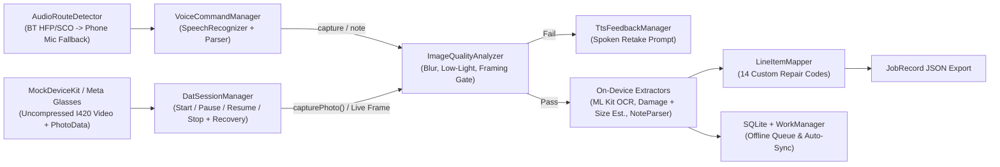

# FieldCapture

Hands-free field inspection Android app built with **Kotlin**, **Jetpack Compose**, and **Meta Wearables DAT 1.1.0** (`mwdat-core`, `mwdat-camera`, `mwdat-mockdevice`).

The goal is simple: a technician walks through a water-damaged space without touching their phone, speaks three commands (`capture nameplate`, `capture damage [room] [surface]`, `note: [text]`), and walks out with a structured JSON job record and a draft list of repair line items.

## Architecture



## Setup (< 10 Minutes on a Clean Machine)

**Requirements:** JDK 17, Android SDK (API 36 platform, build-tools 36.0.0, platform-tools), and an Android 11+ phone (API 30+).

1. Clone the repo:
   ```bash
   git clone https://github.com/dhanoliya-ji/FieldCapture.git
   cd FieldCapture
   ```
2. Create `local.properties` in the project root (everything works offline with zero paid keys; `gemini_api_key` is optional):
   ```properties
   sdk.dir=C\:\\Users\\<you>\\AppData\\Local\\Android\\Sdk
   mwdat_application_id=0
   mwdat_client_token=0
   gemini_api_key=
   ```
3. Run the unit tests:
   ```bash
   ./gradlew testDebugUnitTest
   ```
4. Build and install on a connected Android phone:
   ```bash
   ./gradlew installDebug
   ```
5. Walk through a test session:
   - Grant Bluetooth, Microphone, and Camera permissions on launch.
   - Tap **Start** (auto-pairs Mock Ray-Ban Meta with the phone's back camera, or open **Mock Glasses** first to feed a recorded `.mp4` or mock photo).
   - Tap **Start Hands-Free Mic** (or use the quick buttons / text box) to trigger `"capture nameplate"`, `"capture damage kitchen north wall"`, and `"note: subfloor soft by the cabinet"`.
   - Test **Disconnect Recovery**: open **Mock Glasses** → **Drop-off (Off)**, then **Power On** → **Unfold** → **Don**.
   - Test **Offline Queue**: tap the **ONLINE • Queue:N** chip to switch to **OFFLINE**, capture frames, then tap again to restore **ONLINE** and watch `WorkManager` flush the queue.

## Key Engineering Decisions

### 1. DAT 1.1.0 Lifecycle & Disconnect Recovery
DAT 1.1.0 uses a two-step startup: `Wearables.createSession(AutoDeviceSelector())` followed by waiting for `DeviceSessionState.STARTED` before calling `session.addCamera(...)` and `stream.start()`.
- **Pause/Resume** stops only the `Camera` capability while keeping `DeviceSession` connected.
- **Disconnect Recovery** watches for unexpected `DeviceSessionState.STOPPED` / `StreamState.STOPPED` transitions while a walk-through is active, keeps the SQLite job and upload queue intact, and automatically recreates the session when `activeDeviceFlow()` sees the glasses return.

### 2. Why Audio Falls Back to the Phone Mic in MockDeviceKit
DAT 1.1.0 exposes `Camera` and `Display` capabilities—there is no DAT audio stream API. On real Meta glasses, mic audio arrives over standard Android Bluetooth HFP/SCO (`AudioDeviceInfo.TYPE_BLUETOOTH_SCO`). Because `MockDeviceKit` does not register a virtual SCO input in `AudioManager`, `AudioRouteDetector` checks for a BT SCO/BLE headset and falls back to the phone mic when none is present, logging the reason into `JobRecord.sessionTelemetry`.

### 3. On-Device Quality Gate Thresholds (`ImageQualityAnalyzer`)
| Check | Metric | Threshold | Spoken Retake Prompt |
|---|---|---|---|
| Low light | Mean luminance / dark ratio (`Y < 35`) | `< 48.0` or `> 72%` dark | *"Too dark. Add light or step closer and retake."* |
| Overexposure | Bright pixel ratio (`Y > 240`) | `> 65%` bright | *"Glare or overexposed. Angle away from light and retake."* |
| Motion blur | 3×3 Laplacian variance (at ≤320px) | `< 110.0` | *"Too blurry. Hold steady for one second and retake."* |
| Bad framing | Outer 12% border edge share / center contrast | `> 45%` border edges or `< 18%` center contrast | *"Bad framing. Center the target in view and retake."* |

### 4. Models Chosen & Cost per Job
- **On-device default (\$0.00 / job)**: Google ML Kit Text Recognition (`com.google.mlkit:text-recognition:16.0.1`) + regex/brand-dictionary parsing (`NameplateParser`), Android `SpeechRecognizer` + `VoiceCommandParser`, and pixel-based `DamageAnalyzer` / `MonocularSizeEstimator`.
- **Optional cloud vision (< \$0.005 / job)**: `GeminiVisionClient` (`gemini-2.5-flash`) activates only if `gemini_api_key` is set in `local.properties` and the device is online.

### 5. Product Judgment (What I Cut & Why)
Designing for a tech wearing gloves in a dark, offline attic:
- **Cut manual crop / bounding-box UI**: Impossible with work gloves. `MonocularSizeEstimator` estimates area automatically from color/luminance segmentation + camera FoV, with optional tape-measure comparison afterwards in the **Job** tab.
- **Cut mandatory cloud login / cloud-only inference**: Basements and attics have no signal. Everything runs locally and queues in SQLite until connectivity returns.
- **Cut multi-step retake modals**: Quality failures speak a short TTS prompt so the tech keeps working hands-free, with a single **Keep Anyway** button if a retake isn't possible.

## Known Limitations
- **Monocular size accuracy**: Without a known-size reference object in frame, `FOV_DISTANCE_PRIOR` assumes a 1.2 m standoff and 82° HFOV; steep angles or very close/far shots add proportional error.
- **SpeechRecognizer timeouts**: Android's built-in `SpeechRecognizer` can pause between utterances in noisy spaces, so `VoiceCommandManager` auto-restarts it and provides quick-trigger buttons as a backup.
- **Real captures required**: The 40+ frame eval set and 3 sample JSONs must be recorded in your own environment (no synthetic/internet footage).

## What I Would Do With Two More Weeks
1. Auto-detect standard 4.5" × 2.75" electrical wall plates in damage frames to switch `MonocularSizeEstimator` from `FOV_DISTANCE_PRIOR` to `REFERENCE_SCALE` automatically.
2. Replace Android `SpeechRecognizer` with an offline wake-word + local Whisper.cpp model to eliminate recognition beeps and network dependency.
3. Add earcon chimes before TTS prompts so a tech hears pass/fail feedback immediately in noisy mechanical rooms.

## Docs & AI Tools Used
- [Research Memo (Meta Glasses & DAT 1.1.0)](docs/RESEARCH_MEMO.md)
- [Engineering Challenges & Solutions](docs/CHALLENGES_AND_SOLUTIONS.md)
- [Evaluation Report](docs/EVAL_REPORT.md)
- **AI Tools**: I used Antigravity (Gemini) as a coding assistant to inspect the official `meta/meta-wearables-dat-android` sample repo, scaffold the Jetpack Compose screens and SQLite/WorkManager boilerplate, and draft unit tests. I handled the device testing on my Samsung Galaxy M30s, debugging the Exynos preview issue, architecture choices, and threshold/UX refinements.
