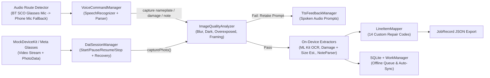

# FieldCapture — Hands-Free Field Inspection on Meta AI Glasses (DAT 1.1.0)

FieldCapture is an Android application built with **Kotlin**, **Jetpack Compose**, and the **Meta Wearables Device Access Toolkit (DAT 1.1.0)** + **Mock Device Kit**. It turns a technician's hands-free walk-through into a structured JSON job record and a draft list of repair estimate line items.

## Architecture



## Setup in Under 10 Minutes (Clean Machine)

### Prerequisites
- **JDK 17** (e.g., Microsoft OpenJDK 17 or Android Studio JBR)
- **Android SDK** (API 36 platform + build-tools 36.0.0 + platform-tools)
- **Android Phone** (Android 12+ / API 31+) or Android Emulator

### Steps
1. **Clone the repository**
   ```bash
   git clone <repo-url>
   cd FieldCapture
   ```
2. **Configure `local.properties`** (optional: add a free Google AI Studio key for optional Gemini 2.5 Flash vision enhancement; the app works 100% offline/free without it using on-device ML Kit OCR + heuristics):
   ```properties
   sdk.dir=C\:\\Users\\<you>\\AppData\\Local\\Android\\Sdk
   mwdat_application_id=0
   mwdat_client_token=0
   gemini_api_key=
   ```
3. **Run unit tests**
   ```bash
   ./gradlew testDebugUnitTest
   ```
4. **Build & install debug APK**
   ```bash
   ./gradlew installDebug
   ```
5. **Run with Mock Device Kit (no glasses required)**
   - Open **FieldCapture** on your phone and grant Bluetooth, Microphone, and Camera permissions.
   - Tap **Mock Glasses** -> **1-Tap Enable, Pair, Unfold, Don & Back Camera** (or pick a recorded walkthrough video / mock photo).
   - Tap **Start** to begin the DAT `DeviceSession` and camera `Stream`.
   - Tap **Start Hands-Free Mic** (or use the quick command buttons / text bar) and speak:
     - `"capture nameplate"`
     - `"capture damage kitchen north wall"`
     - `"note: subfloor soft by the cabinet"`
   - Test **Disconnect Recovery**: open **Mock Glasses** -> **Drop-off (Off)** while streaming, then tap **Power On** -> **Unfold** -> **Don** and watch the session auto-recover without losing any queued captures.
   - Test **Offline Queue**: tap the **ONLINE • Queue:N** chip to toggle **OFFLINE** mode, capture frames, then toggle back to **ONLINE** to watch WorkManager flush the queue.

## Core Design & Thresholds

### 1. DAT 1.1.0 Session Lifecycle & Disconnect Recovery
- Uses the two-step DAT 1.1.0 lifecycle: `Wearables.createSession(AutoDeviceSelector())` -> wait for `DeviceSessionState.STARTED` -> `session.addCamera(StreamConfiguration(...))` -> `camera.stream.start()`.
- **Pause/Resume**: `pauseSession()` stops the `Camera` capability while keeping the `DeviceSession` alive; `resumeSession()` re-attaches `addCamera()`.
- **Disconnect Recovery**: If `DeviceSessionState.STOPPED` or `StreamState.STOPPED` fires unexpectedly while a walkthrough is active, `DatSessionManager` enters `RECOVERING`, preserves the SQLite job/upload queue, polls `activeDeviceFlow()`, and automatically recreates the session when the device returns.

### 2. Audio Path & Phone Mic Fallback
- **Why fallback is required in MockDeviceKit**: DAT 1.1.0 only exposes `Camera` and `Display` capabilities; glasses microphone audio on real Meta glasses is routed via standard Android Bluetooth HFP/SCO (`AudioDeviceInfo.TYPE_BLUETOOTH_SCO`). MockDeviceKit does not register a virtual SCO audio device in `AudioManager`, so `AudioRouteDetector` detects this gap and automatically falls back to the phone microphone with an explicit UI/telemetry reason.

### 3. On-Device Capture Quality Gate (`ImageQualityAnalyzer`)
| Check | Metric | Threshold | Retake Prompt |
|---|---|---|---|
| **Low light** | Mean luminance / dark ratio (`Y < 35`) | `< 48.0` or `> 72%` dark | *"Too dark. Add light or step closer and retake."* |
| **Overexposure** | Bright pixel ratio (`Y > 240`) | `> 65%` bright | *"Glare or overexposed. Angle away from light and retake."* |
| **Motion blur** | 3×3 Laplacian variance (at ≤320px) | `< 110.0` | *"Too blurry. Hold steady for one second and retake."* |
| **Bad framing** | Outer 12% border edge share / center contrast | `> 45%` border edges or `< 18%` center contrast | *"Bad framing. Center the target in view and retake."* |

### 4. Extraction & Custom Line Items (14 Codes)
- **Nameplates**: On-device Google ML Kit Text Recognition + `NameplateParser` (extracts `make`, `model`, `serialNumber`, `manufactureDate` with quality-modulated confidence scores; optional Gemini 2.5 Flash enhancement when API key is provided).
- **Damage**: Voice-command `room` & `surface` + visual color/texture classification + **Stretch Goal: Monocular Size Estimation** (`MonocularSizeEstimator`) with tape-measure comparison in the Job Record tab.
- **Line Items**: `LineItemCatalog` defines 14 custom codes (`DRW-01`, `DRW-02`, `PNT-01`, `INS-01`, `FLR-01`, `CAB-01`, `BSB-01`, `WTR-01`, `MLD-01`, `PLM-01`, `PLM-02`, `PLM-03`, `CLG-01`, `TST-01`).

## Model Selection & Cost per Job
- **Default (100% Free & Offline)**:
  - **Vision / OCR**: Google ML Kit Text Recognition (`com.google.mlkit:text-recognition:16.0.1`) + deterministic `NameplateParser` and `DamageAnalyzer` color/texture + `MonocularSizeEstimator`. **Cost: \$0.00 / job** (runs entirely on-device).
  - **Speech**: Android `SpeechRecognizer` (device/OS speech engine) + `VoiceCommandParser` + Android `TextToSpeech`. **Cost: \$0.00 / job**.
- **Optional Cloud Vision Enhancement**:
  - **Gemini 2.5 Flash** (`GeminiVisionClient`, enabled only if `gemini_api_key` is set in `local.properties`): chosen for low latency and strong structured JSON extraction on degraded/angled nameplates. Free tier on Google AI Studio costs **\$0.00 / job**; on paid API pricing, ~8 captures/job at ~1,500 input + 250 output tokens each is **< \$0.005 / job**.

## Known Limitations & Manual Steps Required
- **40+ Real-Frame Evaluation & Demo Video**: Real-world photos/videos must be captured on your own device in your own space (this repository includes the `EvaluationEngine` harness and unit tests, without fabricated real-world accuracy numbers).
- **Monocular Size Accuracy**: Without a reference object (`pixelsPerInchOverride`), `FOV_DISTANCE_PRIOR` assumes a 1.2 m standoff distance and 82° HFOV; tilted angles or closer/farther standoffs introduce proportional scale error.
- **MockDeviceKit Still Capture**: When using `setCameraFeed(CameraFacing.BACK)` without `setCapturedImage(Uri)`, `stream.capturePhoto()` behavior depends on the MockDeviceKit runtime; if needed, select a mock photo via **Pick Mock Photo** in the Mock Glasses sheet.

## What I Would Do With Two More Weeks
1. **Aruco / 4.5" Outlet-Cover Auto-Scale Detector**: Automatically detect standard electrical wall plates (4.5" × 2.75") or floor tiles in damage frames to switch `MonocularSizeEstimator` from `FOV_DISTANCE_PRIOR` to `REFERENCE_SCALE` hands-free.
2. **On-Device Whisper.cpp / Porcupine Wake-Word**: Replace Android `SpeechRecognizer` (which beeps and times out in noisy crawlspaces) with an always-on offline wake-word + local Whisper tiny/base model.
3. **Glasses-First Audio Confirmation**: Add short earcon chimes + terse 2-word TTS confirmations tuned for noisy job sites.

## AI Tools Used
- **Antigravity (Gemini)**: Used for inspecting the official `meta/meta-wearables-dat-android` repository, scaffolding the Kotlin/Compose architecture, implementing the DAT 1.1.0 session manager, quality analyzer, extractors, and unit tests, and verifying compilation via Gradle.
